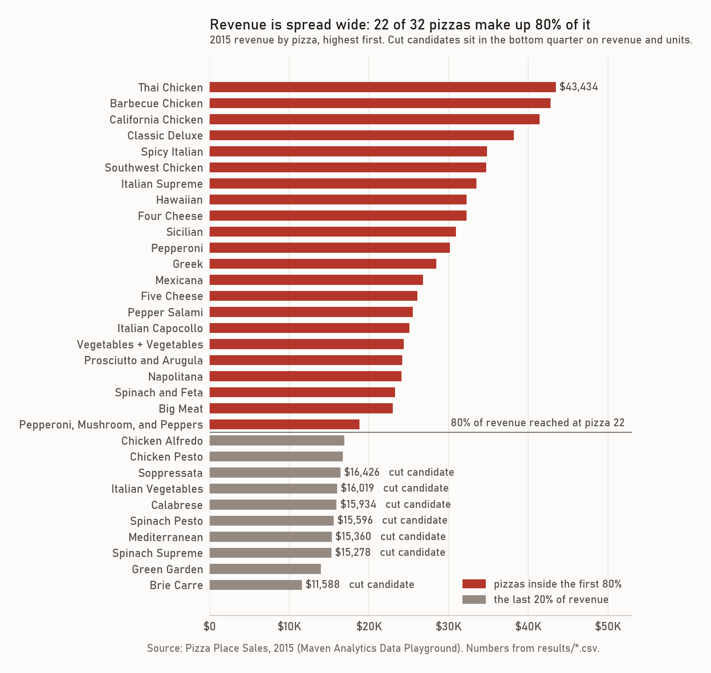
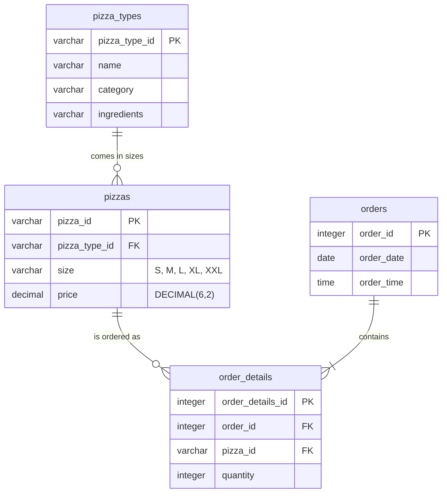

# sql-analytics

[](https://github.com/rawatneelmayank1-sire/sql-analytics/actions/workflows/ci.yml)
[](LICENSE)

Business questions about a pizza restaurant, answered in SQL. One year of real orders
(21,350 orders, 48,620 order lines, 2015) goes into a normalised DuckDB database, and twelve
queries answer the decisions a manager actually makes: what to cut from the menu, when to
staff, which sizes to keep, whether sales are growing. One command runs everything.

## What the data says

1. **The menu is not 80/20.** 22 of 32 pizzas are needed to reach 80% of revenue. Seven
   pizzas are in the bottom quarter on both revenue and units (13.0% of revenue together);
   Brie Carre is the clear cut, with half the sales of the next lowest.
2. **Staff for lunch first.** Weekdays peak at 8.1 to 8.4 orders per hour from 12:00 to
   13:59; dinner is a second, flatter peak. Friday is the busiest day (70.8 orders, 40% more
   than Sunday).
3. **XL and XXL do not pay.** Only one pizza comes in those sizes and they earn 1.8% of
   revenue. XXL sold 28 pizzas all year.
4. **Sales are flat.** Revenue per open day was $2,286 in the first half and $2,283 in the
   second. One-pizza orders are 38% of orders but 16% of revenue, so a second-pizza offer is
   the clearest lever; no two pizzas are bought together much more than chance (lift 1.22 at most).

<picture>
  <source media="(prefers-color-scheme: dark)" srcset="reports/menu_pareto-dark.png">
  
</picture>

Full numbers, sources and recommendations: [FINDINGS.md](FINDINGS.md). More charts:
[staffing heatmap](reports/staffing_heatmap.png), [daily trend](reports/daily_trend.png),
[size mix](reports/size_mix.png) (each has a `-dark` version).

## Business questions

| Decision | Question | SQL technique | File |
|---|---|---|---|
| Trust the data | Did the load work? Any orphans, duplicates, bad prices? | `UNION ALL` of named checks, `LEFT JOIN ... IS NULL`, `LAG` | [02_data_quality.sql](sql/02_data_quality.sql) |
| Baseline | Orders, revenue, average order value, orders per day | order-grain CTE, `COUNT(DISTINCT)` | [03_headline_kpis.sql](sql/03_headline_kpis.sql) |
| Menu | How concentrated is revenue (80/20)? | `RANK()`, running `SUM() OVER` | [10_menu_pareto.sql](sql/10_menu_pareto.sql) |
| Menu | Which pizzas are weak on both revenue and volume? | two `NTILE(4)` windows, `CASE` | [11_menu_cut_candidates.sql](sql/11_menu_cut_candidates.sql) |
| Staffing | Orders per hour on a typical day of each weekday | `ISODOW`, `HOUR`, per-day averages | [20_staffing_hour_weekday.sql](sql/20_staffing_hour_weekday.sql) |
| Sizes | Do XL and XXL earn their place? | share of total with `SUM() OVER ()` | [30_size_mix.sql](sql/30_size_mix.sql) |
| Growth | Week-over-week change, full weeks only | `DATE_TRUNC`, `LAG` | [40_weekly_growth.sql](sql/40_weekly_growth.sql) |
| Growth | Daily trend without the noise | `GENERATE_SERIES` calendar, 7-day `AVG() OVER (ROWS ...)` | [41_daily_rolling_7d.sql](sql/41_daily_rolling_7d.sql) |
| Promotions | Which pizzas are bought together? | self-join, support, confidence, lift | [50_market_basket.sql](sql/50_market_basket.sql) |
| Planning | Which months are strong once open days are counted? | revenue per open day, index vs `AVG() OVER ()` | [60_seasonality_monthly.sql](sql/60_seasonality_monthly.sql) |
| Ticket size | What drives average order value? | `GROUPING SETS`, `PARTITION BY` shares | [70_aov_drivers.sql](sql/70_aov_drivers.sql) |
| Stock | Which ingredients go into the most pizzas sold? | `UNNEST(STRING_SPLIT())` to first normal form | [80_ingredient_demand.sql](sql/80_ingredient_demand.sql) |

Every file opens with the question, why a manager cares, and the technique used.

## Quick start

```bash
python -m pip install -r requirements.txt
make all        # download data -> run every query -> charts -> tests
```

Without `make` (for example on Windows):

```bash
python scripts/download_data.py          # fetches the four CSVs into data/raw
PYTHONPATH=src python -m sql_analytics.run   # PowerShell: $env:PYTHONPATH="src"
python -m pytest -q
```

Results land in `results/*.csv` (one per query) and charts in `reports/*.png`. Add
`--db pizza.duckdb` to keep the database file and explore it with the DuckDB CLI.
MySQL and PostgreSQL equivalents are listed in [sql/DIALECTS.md](sql/DIALECTS.md).

## Schema



Prices are `DECIMAL(6,2)` so revenue is exact to the cent. Indexes cover every join key and
`order_date`. A `sales` view joins the four tables into one row per order line.

## Structure

```
sql/                 00_schema, 01_load, then one file per business question
src/sql_analytics/   run.py (loads data, runs every query), charts.py, chart.mplstyle
scripts/             download_data.py (official Maven Analytics source)
data/raw/            the four CSVs, downloaded by make data (not committed)
results/             one CSV per query, committed so findings can be checked
reports/             charts, light and dark
tests/               pytest on a small hand-made fixture
```

## Stack

DuckDB (SQL engine, no server), Python 3.10+, matplotlib (charts), pytest, GitHub Actions.

## Data and license

Data: "Pizza Place Sales" from the [Maven Analytics Data Playground](https://mavenanalytics.io/data-playground/pizza-place-sales),
listed as Public Domain (details in [data/README.md](data/README.md)).
Code: MIT, see [LICENSE](LICENSE). Author: Neelmayank Rawat (rawatneelmayank1@gmail.com).
